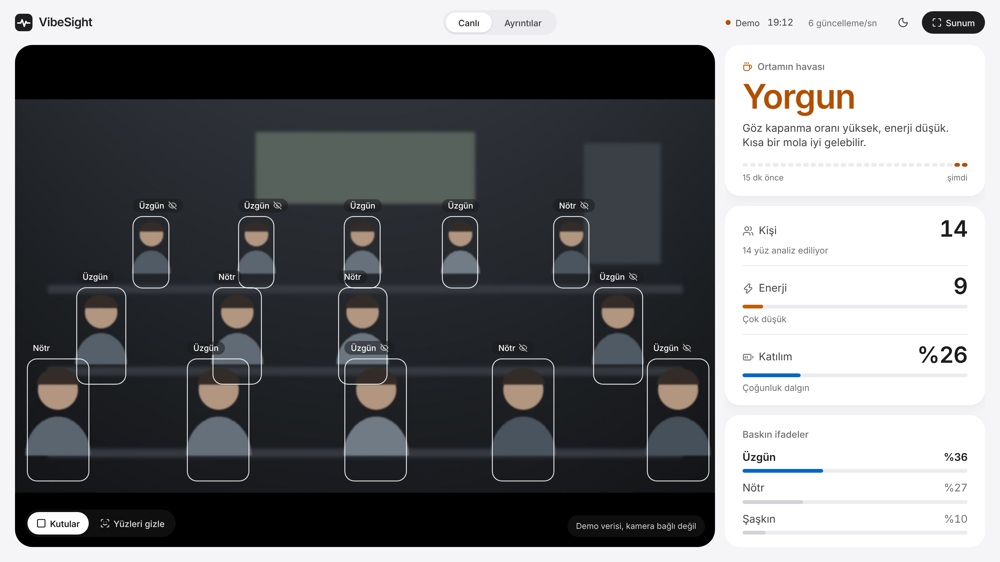

# VibeSight

Bir sınıfın ya da odanın atmosferini kameradan anlık okuyan, tamamen yerel çalışan bir gösterge paneli.
Kişileri sayar, yüz ifadelerini, enerji ve dikkat düzeyini oda bazında özetler.



## Ne ölçer
| Gösterge | Nasıl |
|---|---|
| Kişi sayısı | YOLOX-S kişi tespiti + hafif takipçi, 2 sn medyan |
| Gözlenen ifadeler | FER+ ile eğitilmiş 8 sınıflı ifade modeli, zamanla yumuşatılmış |
| Enerji (0–100) | Uyarılmışlık + göz kapanma oranı (PERCLOS) + esneme + hareket |
| Dikkat | Baş pozu öne dönük yüzlerin oranı |
| Atmosfer | Yukarıdakilerden kural tabanlı oda özeti: Odaklı, Pozitif, Sakin, Yorgun, Gergin |

Görüntü kaydedilmez, kimse tanınmaz, hiçbir veri buluta gitmez. Ayrıntılar: [docs/ETHICS_KVKK.md](docs/ETHICS_KVKK.md).

## Hızlı başlangıç

### Windows
Önce gerekli araçları kurun (PowerShell'de, bir kez):
```powershell
winget install Git.Git OpenJS.NodeJS.LTS
```
```powershell
powershell -ExecutionPolicy ByPass -c "irm https://astral.sh/uv/install.ps1 | iex"
```
```powershell
Set-ExecutionPolicy -Scope CurrentUser RemoteSigned
```
PowerShell'i kapatıp yeniden açın, sonra:
```powershell
git clone https://github.com/erenkadiroglu/VibeSight.git
```
```powershell
cd VibeSight
```
```powershell
.\vs.ps1 doctor
```
```powershell
.\vs.ps1 setup
```
```powershell
.\vs.ps1 demo
```
Tarayıcı http://localhost:5173 adresinde açılır. Demo modu kamera olmadan sentetik bir sınıf gösterir.

### macOS / Linux
Gereksinimler: [uv](https://docs.astral.sh/uv/getting-started/installation/) ve [Node.js 20+](https://nodejs.org).
```bash
make setup
```
```bash
make demo
```

Kamerayı bağlamak için: [docs/CAMERA_SETUP.md](docs/CAMERA_SETUP.md), ardından `.\vs.ps1 dev` (Windows) veya `make dev`.

## Komutlar
| Windows | macOS / Linux | Açıklama |
|---|---|---|
| `.\vs.ps1 setup` | `make setup` | Bağımlılıklar ve modeller |
| `.\vs.ps1 demo` | `make demo` | Kamerasız demo |
| `.\vs.ps1 dev` | `make dev` | Kamera/webcam ile çalıştırma |
| `.\vs.ps1 serve` | `make serve` | Derlenmiş arayüzle tek port: http://127.0.0.1:8000 |
| `.\vs.ps1 camera-test` | `make camera-test` | Tapo bağlantı testi |
| `.\vs.ps1 check` | `make check` | Lint + tip kontrolü + test + derleme (push öncesi) |

`VIBESIGHT_SOURCE` değeri: `mock`, `tapo`, `0` (bilgisayar kamerası), `rtsp://…` veya bir video dosyası yolu.

## İfade modelini eğitmek
Kaggle'ın ücretsiz GPU'sunda yaklaşık 45 dakika sürer: [training/README.md](training/README.md).
Eğitilen model gelene kadar ONNX Model Zoo'daki `emotion-ferplus-8` taban modeli kullanılır.

## Mimari
```
backend/    FastAPI + analiz hattı (ONNX Runtime, MediaPipe; çalışma zamanında PyTorch yok)
frontend/   React + TypeScript + Tailwind gösterge paneli
training/   FER2013 + FER+ eğitim betikleri ve Kaggle defteri
docs/       Plan, kamera kurulumu, veri setleri, model kartı, etik
```
Ayrıntılı plan ve yol haritası: [docs/PLAN.md](docs/PLAN.md).

## Lisans
MIT © Eren KADİROĞLU. Kullanılan model ve veri setlerinin lisansları: [docs/DATASETS.md](docs/DATASETS.md).
